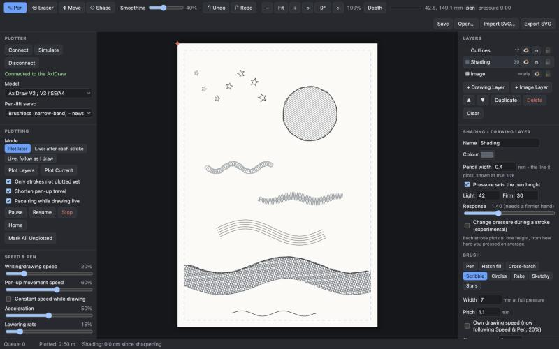

# AxiDraw Live

**Draw with a pressure-sensitive tablet in your browser, and plot it on an [AxiDraw](https://axidraw.com) pen plotter —
live as you draw, after each stroke, or later.**

Most pen-plotter tools start from a finished file. AxiDraw Live treats the plotter as an extension of your hand: you
draw with a Wacom (or any pressure stylus) and the plotter follows, with your pressure setting the pen height, a choice
of brushes that turn gestures into hatching, scribbles or circulism, and the practical things real pencils need — like
pausing to be sharpened.



## Features

- **Live plotting** — each stroke as you lift the stylus, or the plotter following your hand as you draw, with a *pace
  ring* showing how far it can keep up. Or draw first and plot later, in instalments.
- **Pressure → pen height**, per layer, with a light/firm range and response curve (optionally changing during a stroke).
- **Layers** — an image layer to trace over (never plotted) and any number of drawing layers, each with its own colour,
  pencil width, heights, speed and brush. Duplicate, move, lock, hide, reorder.
- **Brushes** — pen, hatch fill, cross-hatch, scribble, circles (circulism), rake, sketchy and stars — tone from line
  density, not only pressure.
- **Shapes and SVG import** — lines, rectangles, ellipses, polygons, and the lines from any SVG file, optionally drawn
  with a brush.
- **Drawing aids** — smoothing (a "lazy string" stabiliser), a partial eraser, zoom, display rotation, depth view.
- **Pencil-friendly plotting** — sharpening pauses by length of line, slow pen lowering, constant-speed drawing, a safe
  height cap for the spring kit, and travel-optimised plot order.
- **Export** an AxiDraw-ready SVG with `+H`/`+S` layer codes and `!` pauses, for Inkscape or `axicli`.
- **Simulate** mode to try everything without a plotter.

## Requirements

- An AxiDraw (any model) connected by USB. Developed on an AxiDraw V3/A3 with the brushless pen-lift servo.
- Python 3.8 or newer.
- A browser — Chrome or Safari pass tablet pressure through. Any pressure stylus works; a mouse works without pressure.
- Developed and tested on macOS. The server is plain Python and should run on Windows and Linux too (use
  `python server.py` in place of the `.command` launcher), but that hasn't been tested.

## Install and run

```bash
git clone https://github.com/Demonboy66/axidraw-live.git
cd axidraw-live
./install.sh            # makes .venv and installs the AxiDraw Python API from Evil Mad Scientist
.venv/bin/python server.py
```

It opens <http://127.0.0.1:8765> in your browser. On a Mac you can instead double-click **Start AxiDraw Live.command**,
which also runs the install on first use. Click **Connect** (or **Simulate**), set the paper size, and draw.

**Pen-lift servo** (under Model): newer AxiDraws have a brushless "narrow-band" servo — the default here. If the pen
doesn't go up and down, choose **Standard servo**.

## Pencils, pressure and the spring kit

Out of the box an AxiDraw's pen rests on the paper under its own weight, so a lower pen-down height doesn't press
harder. To get pressure you need the brushless servo's **spring kit** (or a spring-loaded holder) — and even then,
height only changes the force over a narrow band between first touching the paper and the point where the lift arm
lets go; below that it's constant. A slightly soft surface under the paper widens the band.

- Set **Highest safe height** *before* connecting with the spring fitted, so the spring is never squashed solid
  (connecting raises the pen to the pen-up height).
- Find **Light** where the tip just touches, and **Firm** where the line stops getting darker.
- To keep the tip position the same after sharpening, re-clamp the pencil with the carriage lowered to a fixed
  reference height and the tip resting on the paper.
- Without the spring, untick *Pressure sets the pen height* and use one pen height — tone then comes from brushes and
  layering.

## Using it

### Layers

- **Image** — import a picture to trace over. It's never plotted. Use Move with it selected to drag it; set width/opacity.
- **Outlines** and **Shading** — drawing layers. Each has its own colour, pressure → height range, pen-down speed and
  sharpening interval. 👁 shows/hides, ⎙ includes it in plotting, 🔒 locks it. Add more with **+ Drawing Layer**.
  Layers higher in the list are plotted after (on top of) lower ones.
- **Duplicate** copies the selected layer and its strokes. **Move** drags the selected layer's contents; the arrow keys
  nudge it 0.5 mm (Shift: 5 mm). Shift-drag with Move shifts the whole drawing instead. Moved or copied strokes count
  as not plotted yet.

### Erasing

With the Eraser selected, its options float at the top-left of the canvas: **Whole strokes** removes anything the
eraser touches (a brush stroke as a group); **Only what it touches** cuts out just the part under the eraser, splitting
strokes where it crosses them. Set the **width** in millimetres on the paper ([ and ] change it).

### Rulers

Millimetre rulers run along the paper's top and left edges, measured from its top-left corner (the same numbers as the
position readout), with blue marks showing where the stylus is. Their ticks get finer as you zoom; zoomed in so far
that an edge is off-screen, the ruler stays at the window's edge; and they turn with the view. **Rulers** (or U) hides
them.

### Turning the view

⟲ / ⟳ in the toolbar (or R / Shift R) turn the view 15° at a time; Space + Option drag turns it freely (add Shift for
15° steps). Click the angle, or press 5, to straighten it. It's like turning the paper on a desk to draw comfortably:
only the screen turns — the drawing, its position and the plot don't change. Shapes stay square to the paper.

### Smoothing, lines and shapes

- **Smoothing** (toolbar slider): the line is pulled along behind the stylus on a short string (up to 4 mm), so hand
  wobble doesn't reach it; a faint blue line shows the string while you draw. When you lift, the line finishes where
  the stylus was. It works with every brush and with live plotting.
- **Shape tool** (S): drag out a **Line**, **Rectangle**, **Ellipse** or **Polygon** (set the sides). Shift makes
  squares, circles and regular polygons and snaps lines to 15° steps; Option draws from the centre. Shapes are plain
  outlines; if the layer has a brush, choose **With layer brush** in the shape bar to draw them with it — a rectangle
  with Hatch (Outline) becomes a hatched rectangle, a line with Stars a row of stars. Shapes are trimmed to the drawing
  area.

### Importing SVG shapes

**Import SVG…** brings in the lines of an SVG file — paths, lines, polylines, polygons, rectangles, circles and
ellipses, with their transforms (curves are followed in 0.2 mm steps). A panel lets you set the width (original size,
fit to paper, or any width), the pressure to plot it with, and — if the selected layer has a brush — whether to draw it
with that brush (e.g. Hatch fill, Outline area, turns imported outlines into hatched shapes).

It's placed in the middle of the paper on a **layer of its own** with the selected layer's pen settings, ready to drag
with Move; use **Duplicate** for more copies. Text must be converted to paths first (Inkscape: Path ▸ Object to Path);
images and `<use>` copies are skipped.

### Brushes

Each drawing layer has a **Brush** (in its settings). A brush turns your stroke into the lines that get plotted — so
tone can come from how much line there is, not only from pressure:

- **Pen** — the line as drawn.
- **Hatch fill** — parallel lines. *Sweep* paints a band of the set width; *Outline* fills the shape you draw round.
  Pressing harder packs the lines closer.
- **Cross-hatch** — like hatch, but pressing harder adds directions (one, then 90°, then the diagonals).
- **Scribble** — a zigzag along the stroke, wider where you press harder.
- **Circles** — small overlapping loops (circulism), packed closer with pressure — good for coloured pencil.
- **Rake** — several parallel lines that spread apart with pressure.
- **Sketchy** — the stroke drawn two or three times, loosely, with overshooting ends.
- **Stars** — five-pointed stars along the stroke, bigger where you press harder; outline or pentagram, upright with a
  little random turn or pointing along the stroke. A tap makes one star.

Hatch lines sit on a fixed grid so separate strokes line up; **Join lines** links neighbouring lines into
back-and-forth strokes for far fewer pen lifts (it leaves short turns along the edges). Brush lines are trimmed to the
drawing area, count towards sharpening, and the eraser removes a whole brush stroke at once. The screen shows exactly
what will plot. "Follow as I draw" uses the plain pen — brush strokes plot when you lift the stylus.

### Plotting

- **Plot later** — draw freely, then **Plot Layers** (every layer with ⎙) or **Plot Current**. "Only strokes not plotted
  yet" lets you plot in instalments; pen-up travel is shortened automatically.
- **Live: after each stroke** — each stroke is sent when you lift the pen.
- **Live: follow as I draw** — the plotter follows the stroke while you draw it. It lands once it has felt the first
  ~1.5 mm of pressure.
- Strokes waiting for the plotter show as blue dashes; the orange/red cross is the pen's position.
- **Pace ring** (live modes): the circle around the cursor is how far the plotter draws in about one second, measured
  as it goes. Keep each second's drawing roughly inside it and the plotter keeps up. Green = keeping up, amber = over
  1 s behind, red = over 3 s behind; a dashed line joins the pen to your cursor while it catches up. Nothing is lost
  when it falls behind — strokes queue and it finishes them — but live drawing feels best within the ring.
- Following as you draw is slower than whole strokes: the plotter stops briefly at each point it's sent (points go about
  every 1 mm). Whole strokes (after each stroke, or plot later) are planned as one smooth path and run much faster.
- **Pause / Resume / Stop / Home**. Stop drops everything queued and lifts the pen.
- **Return home after plotting** (on by default): after Plot Layers or Plot Current, the carriage parks in the home
  corner, as in Inkscape. Live drawing doesn't return between strokes.
- **Home position:** the AxiDraw can't sense where it is — when you **Connect**, wherever the carriage sits counts as
  home (0, 0). Put it in the home corner before connecting; **Disconnect** returns it home and releases the motors.

### Moving the pen by hand

**Move the Pen** (left panel) jogs the raised pen in steps of 0.1, 1 or 10 mm, with a readout of where it is — from
home and on the paper. Hand moves wait while a plot is running.

- **Paper corner is here:** jog the tip over the paper's top-left corner, then click it — Paper at X/Y is set to the
  pen's position, so the drawing lines up with the sheet exactly.
- **Frame:** traces the outline of everything set to plot (or the margin, if nothing is drawn) with the pen raised,
  like a laser cutter's framing — a quick check that the drawing lands where you expect.

### Plot order

- **Plot later:** layer by layer, bottom of the list first (so upper layers go on top). Within a layer, with
  *Shorten pen-up travel* ticked, it repeatedly picks the stroke whose nearest end is closest to the pen, drawing it
  backwards if that end is closer. Unticked, strokes go in the order and direction you drew them — use that when the
  landing point or direction matters.
- **Live modes:** the order you draw, straight away.
- **Export SVG:** layer by layer from the bottom; within a layer grouped by pen height (lightest first) and split at
  sharpening pauses, in drawing order. Inkscape's AxiDraw settings may reorder further.

### Pressure and heights

Heights are AxiDraw pen positions 0–100; lower numbers put the pen lower. **Light** is the height for the lightest
touch, **Firm** for full pressure, **Response** bends the curve; heights can have tenths. Use **Test height** with
**Pen Down / Pen Up**, then **Use as Light** and **Use for Layer**, to find good values — or plot the calibration sheet
from `tools/axidraw_calibration.py`. Normally a stroke plots at one height (its average pressure). Tick **Change pressure during a stroke**
for the pen to rise and fall as you press — experimental; the servo lags slightly behind the line.

**Writing/drawing speed** and **Pen-up movement speed** in Speed & Pen are Inkscape's speed settings. Every layer
draws at the writing/drawing speed unless you tick **Own drawing speed** in its settings. **Constant speed while
drawing** keeps the pencil at an even pace instead of speeding up and slowing down along each line (Inkscape's "Use
constant speed when pen is down") — for more even tone.

**Lowering rate** in Speed & Pen is how gently the pen lands — keep it low for clean pencil lines.

**Highest safe height** (Speed & Pen): no height the app sends — pen-up, test or drawing — goes above it. With the
spring kit, find where the spring is almost squashed solid (start pen-up at 50 and step up by 5) and set it a few
below. Set it *before* connecting with the spring fitted, since connecting raises the pen. 100 = no limit.

### Positioning

Set the paper size and where its top-left corner sits relative to the plotter's home position (Paper at X/Y).
Nothing is plotted outside the margin. **Position the Drawing** moves/scales/rotates everything (Shift-drag with the Move tool drags it).

### Sharpening

Set **Sharpen every** (cm of line) on a layer — about 40 cm for a hard coloured pencil. The plotter pauses with a
banner when it's due; sharpen, then press **Sharpened – Resume**. **Just Sharpened** restarts the count by hand.

### Files

**Save / Open** keep the whole drawing (including images) as `.axlive.json`; it's also autosaved in the browser
(IndexedDB), so a reload or closed tab doesn't lose it.
**Export SVG** writes an AxiDraw-ready SVG for Inkscape or `axicli`: one layer per drawing layer and pen height, named
with `+H` (height) and `+S` (speed) codes and `!` pauses where sharpening is due.

### Keys

U rulers · R / Shift R turn the view 15° · 5 straighten · Space + Option drag turn freely · [ ] eraser size · P pen · E eraser · M move · S shape · Space-drag or middle-drag to pan · pinch / ⌘-scroll to zoom · 0 fit · ⌘Z / ⇧⌘Z undo/redo · ⌘S save

## How it works

`server.py` is a small standard-library web server. It serves the app from `web/` and runs one worker thread that
drives the AxiDraw through the AxiDraw Python API's interactive mode, in millimetres. The browser sends strokes as
JSON (`/api/strokes`, or `/api/stream` while following your hand); each stroke carries its pen heights and speed.
Whole strokes are plotted as one planned path; pressure changes during a stroke move the pen servo directly.

```
web/index.html, style.css   the interface
web/app.js                  drawing, layers, plotting, files
web/brushes.js              the brushes (pure functions: gesture in, lines out)
server.py                   the plotter bridge
tools/axidraw_calibration.py   a pressure calibration sheet (SVG)
```

## Safety

- The server only listens on your own computer, and its API only answers the app's own page — other websites open in
  your browser can't send the plotter commands.
- If a live stroke stops arriving mid-stroke (the page closed or crashed), the pen is lifted after 3 seconds rather
  than being left down on the paper.
- If the AxiDraw is unplugged or its power is switched off, the app notices within a few seconds, stops, and asks you
  to put the carriage back in the home corner before connecting again.
- **Highest safe height** caps every pen height the app sends, for the spring kit.

## Notes

- Following as you draw is slower than plotting whole strokes, as the plotter briefly stops at each point it's sent.
- On macOS, a browser can start reporting a tablet pen as a mouse after a native drop-down menu is opened, losing
  pressure; the app avoids drop-downs in its drawing controls and warns if it happens.


## Acknowledgements

Plotter control uses the [AxiDraw Python API](https://axidraw.com/doc/py_api/) by Windell H. Oskay and
[Evil Mad Scientist Laboratories](https://www.evilmadscientist.com/) — thank you for making the AxiDraw so open to
tinkering. The API is licensed separately (GNU GPL v2 or later); it isn't included in this repository, and
`install.sh` downloads it from Evil Mad Scientist. The pressure behaviour of the spring kit follows their *Brushless
Servo Motor Use Instructions, Appendix: Spring Kit*.

AxiDraw is a trademark of Evil Mad Scientist Laboratories. This project isn't affiliated with or endorsed by Evil Mad
Scientist or Bantam Tools.

## License

[MIT](LICENSE) © 2026 bedtime infusion
